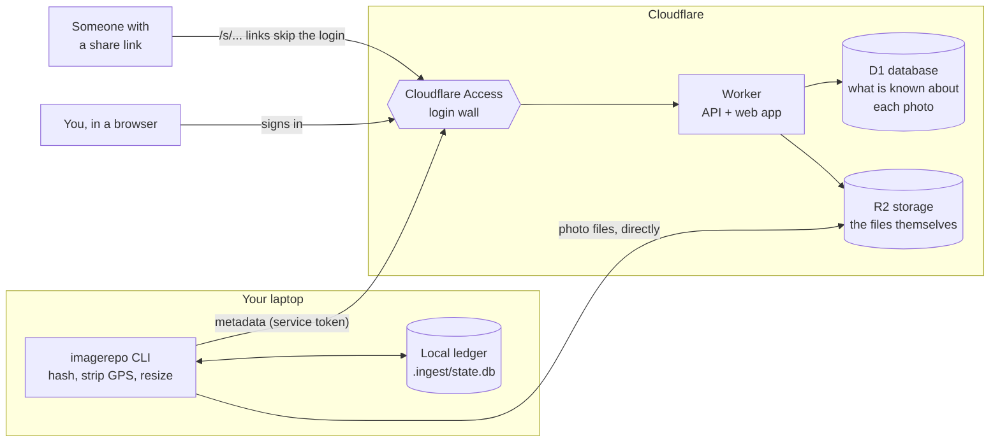
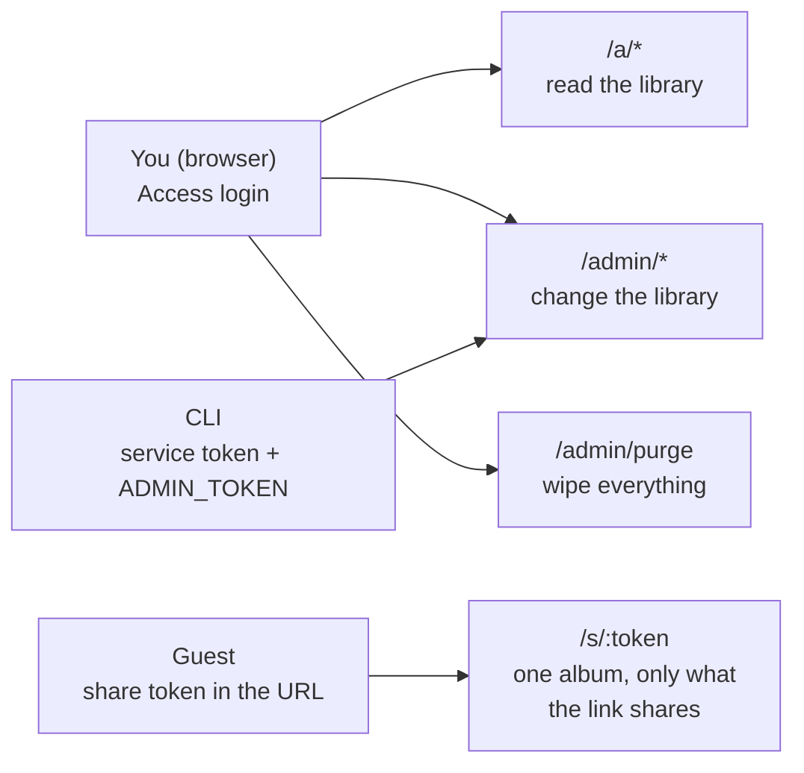
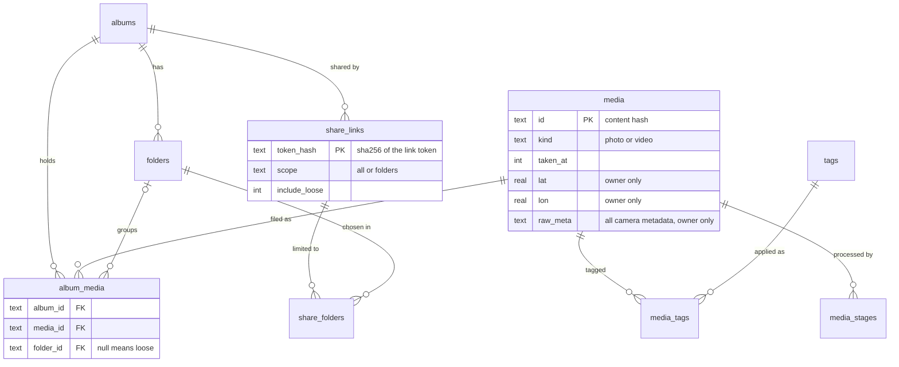
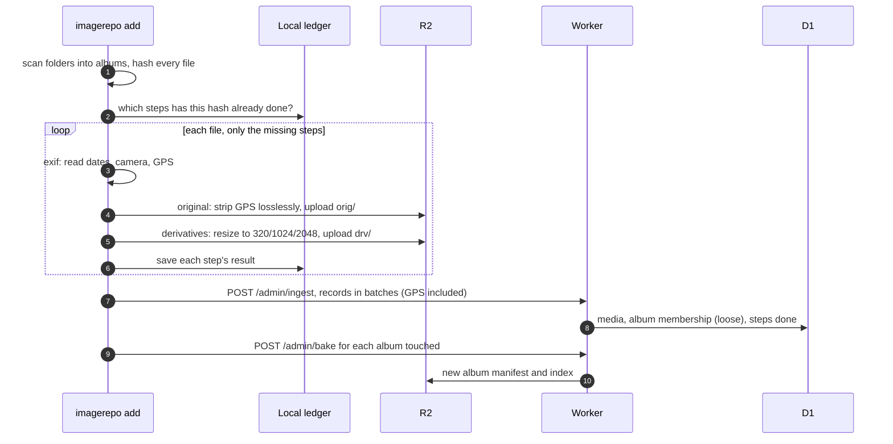
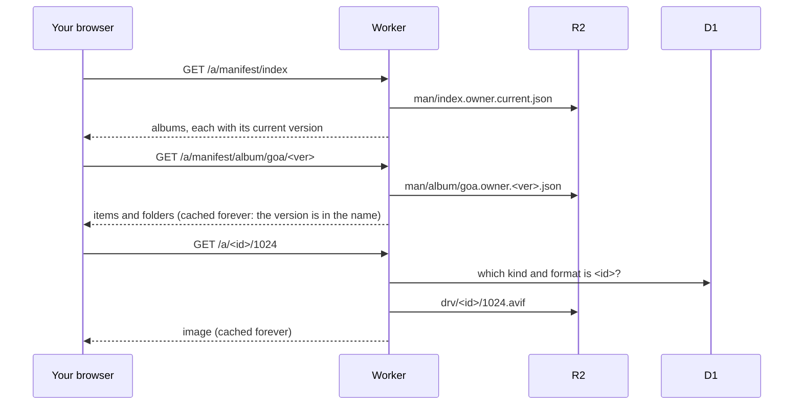
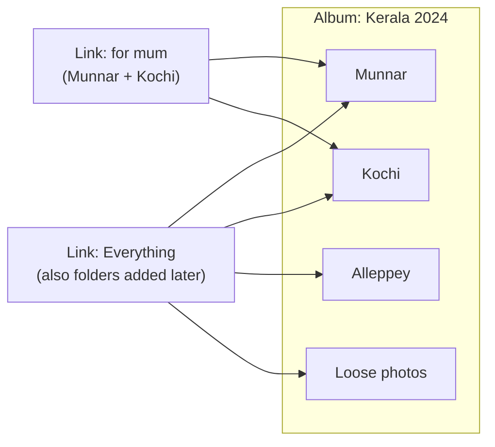
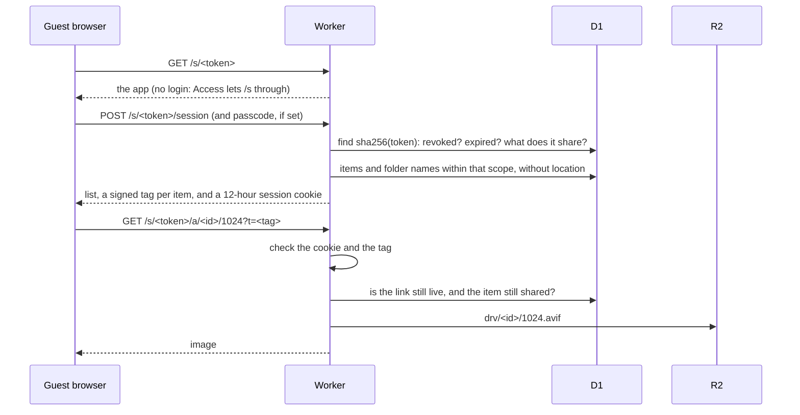
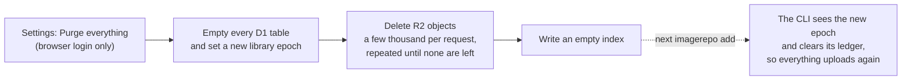
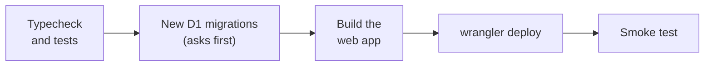

# ImageRepo

A private photo and video library on Cloudflare R2 + D1, with revocable share links.

- **Private by default.** The full library and every write route sits behind Cloudflare Access.
- **Share links** are unguessable, revocable, optionally passcoded and expiring. No login for viewers.
- **Location stays in the database.** GPS is read at ingest and stored in D1. It is
  removed from every original the CLI uploads (JPEG, PNG, HEIC and video) without
  touching a pixel, and never written into anything a guest receives.

## How it works

### The big picture



Three ideas hold the design together:

1. **Files and facts are stored apart.** R2 holds bytes: originals, resized
   copies, video posters. D1 holds everything known about them: dates, camera,
   location, albums, folders, tags and share links.
2. **Only the Worker writes to D1.** The CLI uploads files straight to R2, which
   is fast and avoids Worker request-size limits, then tells the Worker what it
   uploaded.
3. **Album pages read pre-built files.** When an album changes, the Worker
   *bakes* it into a JSON file in R2. Opening an album reads that file, not the
   database, so it is fast and cacheable.

### Who can reach what

One Worker serves the web app and three groups of routes. Access sits in front
of all of it; only share links are let through without a login.



| Caller | Gets past Access with | The Worker then checks | Can use |
|---|---|---|---|
| You, in a browser | your Access login | the Access JWT's signature | `/a`, `/admin`, the web app, purge |
| The CLI | an Access service token | the `ADMIN_TOKEN` bearer | `/admin`, except purge |
| A guest | nothing (`/s` bypasses Access) | share token, passcode, signed session cookie, a tag per image, and the link's folder scope | `/s/:token` only |

Purging needs a person: a JWT that carries an email. Neither the CLI's token
nor its service token can wipe the library.

### Where data lives

**R2** keys are built from the file's content hash: the first 32 hex characters
of its SHA-256. The same file always gets the same key, so a duplicate is
uploaded once, a key's content never changes, and browsers can cache it forever.

| Key | What |
|---|---|
| `orig/<id>.<ext>` | the original, with GPS removed |
| `drv/<id>/320.avif`, `1024`, `2048` | resized copies for the grid, tablets and the lightbox (WebP for browser uploads) |
| `post/<id>.jpg` | a video's poster frame |
| `prev/<id>.mp4` | a 720p preview, only for videos browsers cannot play as they are |
| `man/album/<album>.owner.<ver>.json` | a baked album: items, dates, folders (current and previous version kept) |
| `man/index.owner.current.json` | the list of albums, pointing at each album's current version |

**D1** holds the relationships:



- A photo can be in several albums. Within one album it is in at most one
  folder, or loose. Folders are one level deep.
- Moving a photo between folders changes one `album_media` row. Nothing in R2
  moves.
- `settings.library_epoch` changes when the library is purged (see below).

### Adding photos from the laptop



- Processing is a list of **stages**, each with a version. Photos run
  `exif → original → derivatives`; videos run
  `probe → original → poster → preview`. A file is done when every stage has a
  result at its current version. Adding a stage, or bumping a version, turns
  the existing library into a backlog that the next `add` or `retry` works
  through.
- The ledger records each stage as it finishes, so a run that is interrupted
  resumes where it stopped.
- GPS goes to D1 only. A file type the CLI cannot strip is refused, never
  uploaded as it is.

### Viewing the library



An edit, such as a rename, a folder move or a cover change, writes to D1 and
re-bakes the album under a new version. The index then points at the new
version, so the next load sees the change. The **Photos** timeline and **Tags**
are queried from D1 directly, since only you read them.

### Sharing

A link shows either the whole album or chosen folders:



What happens when a guest opens a link:



- Only the SHA-256 of a link's token is stored, so a copy of the database
  contains no working link.
- Tags change every hour, so every viewer of a link requests the same URLs
  and shares cached copies.
- Each image request is also checked against the link in D1. Revoking a link, or
  taking a folder out of it, takes effect at once.
- Guests never receive location fields, or the names of folders outside their
  link.

### Purging and the CLI's memory



D1 is emptied first. If a purge stops partway, the only thing left is files
that nothing refers to, and running it again removes them.

### How a deploy runs



Migrations run before the new Worker and only ever add things, so the old
Worker keeps working while they apply. See [Deploying](#deploying) for the
command.

## Layout

```
packages/
  shared/    types + R2 key layout shared by the CLI, Worker and web app
  ingest/    local CLI: scan, derive, strip, upload, manage share links
  worker/    Cloudflare Worker: admin API, asset serving, guest share routes
  web/       React + Vite app, built to dist/ and served by the Worker
schema.sql   D1 schema
migrations/  D1 changes applied after schema.sql
scripts/     deploy.mts, behind `npm run deploy`
```

## Setup

Requires Node 20+, and `ffmpeg`/`ffprobe` on the machine that runs the CLI.

```bash
npm install

# Cloudflare resources — run these from packages/worker, where wrangler.toml lives
cd packages/worker
npx wrangler d1 create imagerepo        # put the id in wrangler.toml
npx wrangler r2 bucket create imagerepo
npx wrangler d1 execute imagerepo --file=../../schema.sql --remote

# Worker secrets
npx wrangler secret put ADMIN_TOKEN     # bearer token the CLI presents
npx wrangler secret put SHARE_HMAC_KEY  # signs guest sessions and asset URLs
cd ../..

# Migrations, web build, Worker deploy, smoke test
npm run deploy
```

Then put Cloudflare Access in front of the Worker's hostname:

1. Create an Access application for the hostname with a policy that allows only you.
   Set `ACCESS_TEAM` and `ACCESS_AUD` in `packages/worker/wrangler.toml` from it.
2. Add a second, path-scoped application for `/s` with a **Bypass** policy, so
   share links work without a login.
3. Create a service token (Zero Trust > Access > Service Auth) so the CLI can get
   past Access.

Finally, configure the CLI:

```bash
cp .env.ingest.example .env.ingest      # R2 keys, Worker URL, ADMIN_TOKEN, service token
npx imagerepo doctor                    # check tooling + connectivity
```

`npx imagerepo` works from anywhere inside this repo. To type plain `imagerepo`
from any folder, run `npm link` once in `packages/ingest`. If the command is not
found after pulling changes, run `npm install` again.

## Deploying

```bash
npm run deploy                  # the whole thing
npm run deploy -- --dry-run     # checks, and what would change; changes nothing
npm run migrate:local           # apply new migrations to the local dev database
```

`npm run deploy` runs from the repo root, on whatever is checked out:

1. Checks you are logged in to Cloudflare (`npx wrangler login` in
   `packages/worker` if not) and warns about uncommitted changes.
2. Typechecks the Worker and web app, and runs the Worker tests
   (`--skip-tests` skips them).
3. Applies new files in `migrations/` to production D1. Wrangler lists them and
   asks first. Applied files are recorded in the `d1_migrations` table, so each
   runs once. Migrations go before the Worker and are additive, so the running
   Worker keeps working in between.
4. Builds the web app and deploys the Worker.
5. Checks the deployed Worker: the app shell loads, a made-up share link is
   refused (so D1 answers), and `/admin` without credentials is refused or sent
   to the Access login.

Migrations used to be applied by hand, which leaves no record. The first run
recognises those already in the database by what they created, lists them, and
asks to record them as applied rather than run them again.

## Adding photos from your laptop

```bash
npx imagerepo add ~/Pictures/Goa                 # one album, named "Goa"
npx imagerepo add ~/Pictures                     # each subfolder becomes an album
npx imagerepo add IMG_1.jpg IMG_2.jpg -a "Mum"   # these files, into the album "Mum"
npx imagerepo add ~/Pictures/Goa --dry-run       # see what would happen first
```

`add` takes any mix of files and folders. It checks your setup, shows what it
found and which albums are new, asks before uploading, then shows progress and
a summary. When it finishes the photos are visible in the web app.

- **Albums.** A folder's subfolders become albums, and photos sitting directly
  in the folder go to an album named after it. A single file goes to an album
  named after its parent folder. `--album` puts everything in one album, matching
  an existing album by name. `--album-depth` changes how many folder levels form
  the name. Photos always arrive loose in the album, outside any of its folders;
  you sort them into folders in the web app.
- **Safe to re-run.** Anything already in your library is skipped. The same photo
  in two folders is uploaded once and filed in both albums.
- **Resumable.** Progress is saved per file and per step, so an interrupted run
  continues where it stopped.
- **Dry runs are harmless.** `--dry-run` uploads nothing and remembers nothing.

| Command | What it does |
|---|---|
| `add <paths...>` | Add files or folders, with a preview and confirmation. |
| `retry` | Try again: everything that failed or was left unfinished. |
| `failures` | List files that could not be added, and why. |
| `status` | Show what this computer has added. |
| `stages` | Show how far each processing stage has got across the whole library. |
| `process <root>` | `add` for a whole library, without asking. Loose files go to `unsorted`. |
| `flush` | Record uploads the database has not heard about (after a Worker outage). |
| `scan <root>` | Walk a folder and list albums and sizes. Touches nothing. |
| `bake [album]` | Regenerate album manifests. |
| `share create\|list\|revoke\|albums` | Manage share links. |
| `doctor` | Check tooling and cloud connectivity. |

The CLI reads `.env.ingest` and keeps its ledger in `.ingest/state.db`, both at
the repo root, whichever folder you run it from. The ledger only knows what this
computer uploaded. If you delete a photo in the web app, the CLI notices the next
time it has anything to do for that file and leaves it deleted; `add --restore`
brings such items back. After a full purge (see below) the CLI clears its ledger
on its next run, so adding the same folders uploads everything again.

### How processing is organised

Each file goes through a list of stages, defined in
`packages/ingest/src/stages/`:

| | Stages |
|---|---|
| Photo | `exif` → `original` → `derivatives` |
| Video | `probe` → `original` → `poster` → `preview` |

Each stage does one job, uploads its own output, and has a version. The ledger
stores every stage's result against the file's content hash, and the database
records which stages each item has completed (`media_stages`). Nothing keeps a
"finished" flag: a file is done when every stage has a result at its current
version.

That is what makes the pipeline extensible. To add a step, write a stage and add
it to the list in `stages/index.ts`; every item already in the library then lacks
it, and re-running `add` on those folders does only the new step. To redo a step
for everything, bump its version. The Worker exposes the same view to any other runner, under `/admin/stages`:

| Route | Purpose |
|---|---|
| `GET /pending?stage=&version=` | List items still waiting on a stage. |
| `POST /claim` | Take a batch under a lease. Two runners never get the same item, and a crashed runner's lease simply lapses. |
| `POST /report` | Record each item as done or failed. |
| `GET /failed?stage=` | List failures. After five attempts an item is no longer handed out until the stage version changes. |
| `GET /summary` | Counts per stage, version and state. |

## The web app

Open the Worker's hostname and sign in through Access.

- **Photos** is a timeline of the whole library by date.
- **Albums** lets you create, rename, delete and share albums, and move or copy
  items between them.
- **Tags** lets you tag selected items and browse or search by tag.
- Inside an album you can drop photos to upload them from the browser.
- **Folders.** An album can hold one level of folders. **New folder** makes one;
  select photos and use **Move to folder…** to file them, or back out to
  **Loose (no folder)**. The strip above the grid switches between **All
  photos** (every folder combined, by date), **Loose photos**, and each folder.
  Folders are listed most recent first. A folder's cover is its earliest photo
  unless you choose another (**Set as cover…** on any photo in the album).
  Moving photos between folders only changes the database; nothing in R2 is
  copied or moved. Photos dropped while a folder is open go into it.
- Deleting an album keeps its photos unless you tick **Also delete its photos**.
  Photos that are also in another album are kept either way.
- **Settings** (the gear) shows what the library holds, and has **Purge
  everything**: it deletes every photo, video, generated size, album, tag and
  share link from R2 and D1, with no undo. You type `purge everything` to
  confirm. It only works when you are signed in through Access in a browser.
  The CLI's `ADMIN_TOKEN` and service token are refused.

For local development, `npm run -w @imagerepo/web dev` starts Vite and proxies
`/a` and `/admin` to the deployed Worker. `npm run worker:dev` runs the Worker
locally.

## Share links

Create one from an album's Share button, or from the CLI:

```bash
npx imagerepo share create goa-2023 --label "sent to mum" --days 30 --passcode hunter2
npx imagerepo share create goa-2023 --folders "Day 1,Beach" --loose   # only these folders, plus loose photos
npx imagerepo share list
npx imagerepo share revoke <token-hash-prefix>
```

- **What a link shows.** By default, the whole album, including folders added
  to it later. Choose **Only the folders I choose** (or pass `--folders` and
  `--loose`) to share some folders and, optionally, the photos in no folder; a
  folder added later stays private until you tick it. **Change folders** on an
  existing link changes what it shows without changing its URL.
- Guests see only the folders their link shares, plus **All photos**, which
  combines them oldest first, with a toggle for newest first. The names of
  other folders are never sent to them.

- The URL is shown once. Only its SHA-256 is stored, so a database dump exposes
  no live link; if you lose it, revoke and create another.
- `--no-download` lets viewers browse without downloading originals.
- A guest can load only media their link shares. Every image request is checked
  against the link, so revoking it, or taking a folder out of it, applies at
  once; only images already in the guest's browser cache outlive it.

## How media is treated

Ingested with the CLI:

| | stored in R2 | GPS | notes |
|---|---|---|---|
| JPEG original | yes | removed | EXIF, XMP and IPTC segments dropped; pixels bit-identical, ICC profile kept |
| PNG original | yes | removed | EXIF and text chunks dropped; pixels bit-identical, colour profile kept |
| HEIC original | yes | removed | EXIF and XMP overwritten in place; file layout and pixels unchanged |
| AVIF derivatives (320/1024/2048) | yes | n/a | re-encoded, never carries metadata; HEIC is decoded with `sips` on macOS, otherwise ffmpeg |
| Video original (MP4/MOV/M4V) | yes, as MP4 | removed | lossless remux, `-map_metadata -1`, faststart |
| Video poster | yes | n/a | frame grab, then the photo pipeline |
| Video preview (720p) | if needed | n/a | only for non-H.264, or `--preview-all-video` |

A PNG or HEIC whose structure cannot be parsed is refused, not uploaded as it is.
Everything the camera wrote is kept in D1 (`media.raw_meta`), owner-side only.

Pass `--preserve-original` to upload byte-exact originals instead, keeping GPS
in R2. Only do this if R2 is meant to be your archival copy.

Uploaded from the browser:

| | stored in R2 | GPS | notes |
|---|---|---|---|
| "Original" | yes | removed | re-encoded JPEG, at most 4096px wide; the source file is not kept |
| WebP derivatives (320/1024/2048) | yes | n/a | rendered in canvas |

Browser upload is for photos only, records no EXIF (the date is the file's
modified time), and is not an archival copy. Use the CLI for video, bulk
backfill, and anything you want stored at full quality.

## Tests

```bash
npm run -w @imagerepo/ingest test
```

- `test/strip.test.ts`: JPEG GPS removal is lossless and ICC profiles survive.
- `test/formats.test.ts`: the same for PNG and HEIC. The HEIC half needs macOS
  (`sips` makes the fixture) and is skipped elsewhere.
- `test/video.test.ts`: the remux drops location while frames stay bit-identical.
- `test/runner.test.ts`: the whole `add` flow against an in-memory bucket and a
  fake Worker: dry run then real run, interruption and resume, duplicates,
  re-filing into another album, a Worker outage, a stage version bump, and
  conversion of ledgers written before stages existed.
- `test/e2e-local.ts`: the same flow against a real local Worker and database.
  It is not part of `npm test`; the steps to run it are at the top of the file.

```bash
npm run -w @imagerepo/worker test
```

- `packages/worker/test/purge.test.ts`: purge, album and media deletion, and
  manifest cleanup.
- `packages/worker/test/folders.test.ts`: folder create/rename/delete, moving
  photos in and out, covers, ordering, and that a re-sent CLI record keeps its
  folder.
- `packages/worker/test/shares.test.ts`: links limited to folders, what guests
  receive (and do not), changing a link's folders, and assets refused the
  moment they fall outside a link. They run against the real Hono app in Node, with D1 as
  in-memory SQLite (schema plus every migration), R2 as a map, and Access JWTs
  signed by a key the test makes (`test/harness.ts`).

The web app has no tests of its own; the build's `tsc` step is the only check there.
