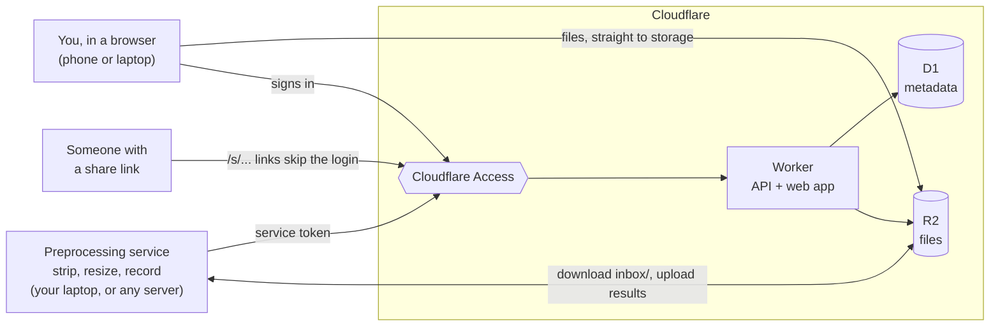
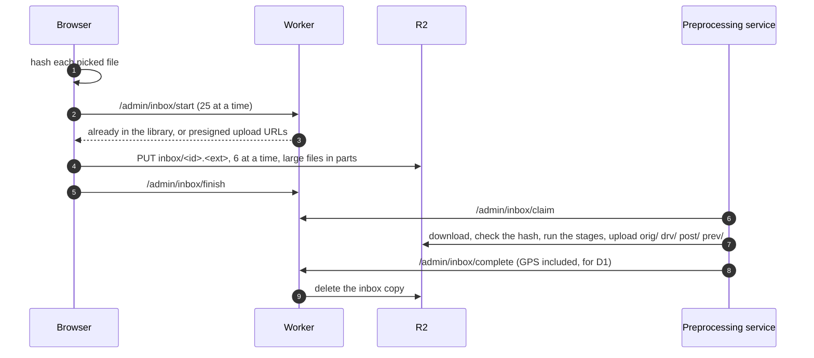
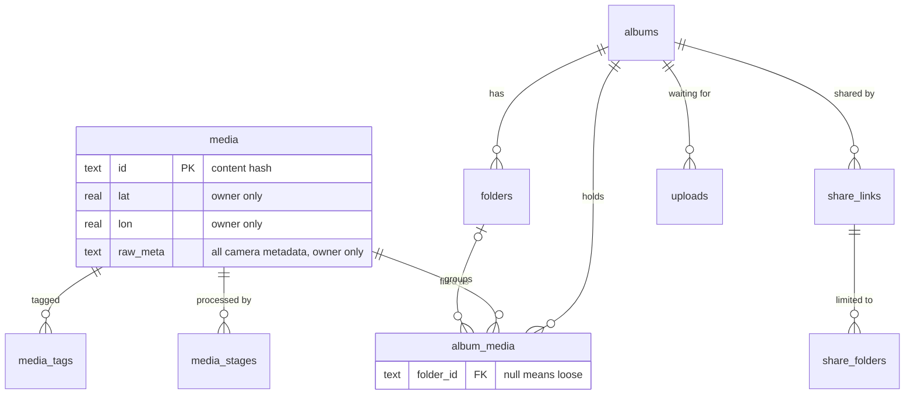
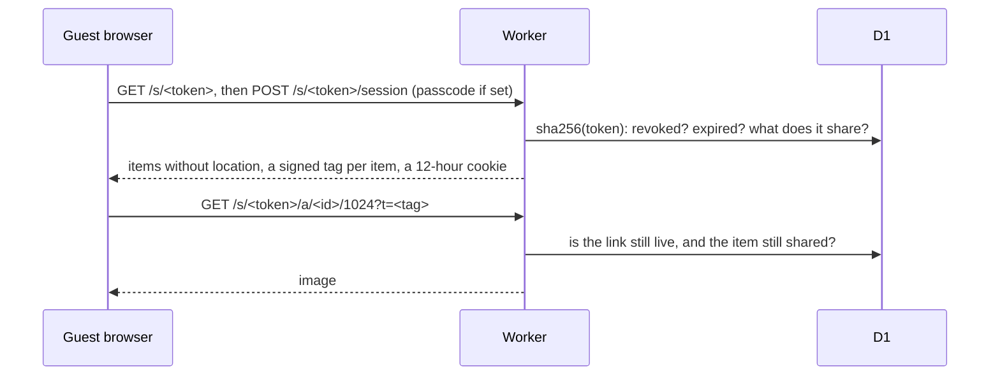

# ImageRepo

A private photo and video library on Cloudflare R2 + D1, with revocable share links.

- **Private by default.** The library and every write route sit behind Cloudflare Access.
- **Share links** are unguessable, revocable, optionally passcoded and expiring. No login for viewers.
- **Full quality.** Files go up exactly as picked, from a phone or a laptop.
- **Location stays in the database.** GPS is read on the way in and stored in D1. It is
  removed from every original kept in R2 without touching a pixel, and never sent to a guest.

## How it works



### Adding photos and videos



- Open an album (or a folder in it) and pick files; they are filed there. A file the
  library already has is not uploaded again, only filed into this album.
- Picking the same files again after an interruption resumes: only the parts R2 is
  missing are sent.
- An open album shows newly processed photos once its queue is empty, or straight away
  from its "new · Show" prompt. Once uploading finishes, the page can be closed.
- The uploader says whether a processing service is running. If none is, uploads still
  go in and wait in storage (seven days at most) until one starts.

The service runs each file through **stages**, each with a name and a version:

| | Stages | Writes |
|---|---|---|
| Photo | `exif` → `original` → `derivatives` | `orig/<id>.<ext>`, `drv/<id>/{320,1024,2048}.avif` |
| Video | `probe` → `original` → `poster` → `preview` | `orig/<id>.mp4`, `post/<id>.jpg`, `drv/` from the poster, `prev/<id>.mp4` (HEVC only) |

D1 records which stages each item has done (`media_stages`), so a new stage, such as
faces, or a new version of one, has a ready-made backlog. See `Preprocessing/README.md`.

### Who can reach what

| Caller | Gets past Access with | The Worker then checks | Can use |
|---|---|---|---|
| You, in a browser | your Access login | the Access JWT's signature | everything, including purge |
| Preprocessing service | its own Access service token | the JWT, and that its token is held to its routes | health, inbox claim/complete/fail/heartbeat/summary, stages |
| A guest | nothing (`/s` bypasses Access) | share token, passcode, signed session cookie, a tag per image, the link's folder scope | `/s/:token` only |

Purging needs a person: a JWT carrying an email. `ADMIN_TOKEN` (a bearer for scripts and
local development) and service tokens are refused.

### Where data lives

**R2** keys are built from the file's content hash, the first 32 hex characters of its
SHA-256. The same file always gets the same key, so a duplicate is stored once, a key's
content never changes, and browsers cache it forever.

| Key | What |
|---|---|
| `inbox/<id>.<ext>` | an upload as sent, location included; never served, deleted once processed |
| `orig/<id>.<ext>` | the original, metadata removed (videos as MP4) |
| `drv/<id>/320.avif`, `1024`, `2048` | resized copies for the grid, tablets and the lightbox |
| `post/<id>.jpg`, `prev/<id>.mp4` | a video's poster frame; a 720p H.264 preview for HEVC |

**D1** holds the relationships:



A photo is in one album (or none, once removed from it), and in at most one of its
folders (folders are one level deep). An upload of a file that is in another album is
refused, naming that album. Filing a photo changes one `album_media` row; nothing in R2 moves.

The app reads D1 live, a page of up to 500 photos at a time, so a change shows on the
next read. Each page is one index range, and album and folder counts are kept on their
rows by triggers, so reads stay small on Cloudflare's free plan.

### Sharing

A link shows the whole album (including folders added later) or chosen folders, with or
without the loose photos. Guests see only what their link shares; other folders' names
are never sent, and nor are location fields.



- Only the SHA-256 of a link's token is stored; the URL is shown once.
- Every image request is checked against the link, so revoking it or taking a folder
  out applies at once.

## Setup

Needs Node 20+, and for the service Python 3.12 and ffmpeg (`brew install python@3.12 ffmpeg`).

```bash
npm install
cd packages/worker
npx wrangler d1 create imagerepo                 # put the id in wrangler.toml
npx wrangler r2 bucket create imagerepo
npx wrangler d1 execute imagerepo --file=../../schema.sql --remote
npx wrangler secret put ADMIN_TOKEN              # bearer for scripts and local dev
npx wrangler secret put SHARE_HMAC_KEY           # signs guest sessions and asset URLs
npx wrangler secret put R2_ACCESS_KEY_ID         # an R2 API token (Object Read & Write),
npx wrangler secret put R2_SECRET_ACCESS_KEY     #   used to sign upload URLs
npx wrangler r2 bucket cors set imagerepo --file r2-cors.json        # set your app's origin in it first
npx wrangler r2 bucket lifecycle add imagerepo inbox-expiry inbox/ --expire-days 7
cd ../..
npm run deploy
```

In `wrangler.toml`, set `R2_ACCOUNT_ID`, and from Cloudflare Access:

1. An Access application for the Worker's hostname, allowing only you: `ACCESS_TEAM`, `ACCESS_AUD`.
2. A second, path-scoped application for `/s` with a **Bypass** policy, so share links need no login.
3. A service token for the processing service, added to a **Service Auth** policy on the first
   application. Its Client ID goes in `PREPROCESS_CLIENT_ID`.

Then the service:

```bash
cd Preprocessing
cp .env.example .env                             # the service token, the R2 key pair
python3.12 -m venv .venv && .venv/bin/pip install -e '.[dev]'
.venv/bin/python -m preprocessing doctor
.venv/bin/python -m preprocessing run            # or: docker compose up --build -d
```

## Deploying

```bash
npm run deploy                  # typecheck + tests, new migrations (asks), web build, deploy, smoke test
npm run deploy -- --dry-run     # what would change; changes nothing
npm run migrate:local           # new migrations into the local dev database
```

Migrations run before the new Worker and only ever add, so the running Worker keeps
working while they apply. The service is not part of a deploy: restart it to pick up
changes.

## The web app

- **Photos** is a timeline of the whole library; **Albums** and **Tags** organise it.
- In an album: **New folder**, select photos and **Move to folder…**, **Set as cover…**,
  **Share**. Uploads made while a folder is open go into it.
- Under an album's title: whether the processing service is running, how many uploads are
  waiting or processing, and what failed, with **Retry** (no re-upload while the file is
  still in storage, 7 days). The album list shows the same counts per album.
- Deleting an album keeps its photos, in no album, unless you tick **Also delete its photos**.
- **Settings** has **Purge everything**: every file, album, tag and share link, no undo,
  confirmed by typing `purge everything`, and only when signed in through Access.

For local development, `npm run -w @imagerepo/web dev` starts Vite and proxies `/a` and
`/admin` to the deployed Worker; `npm run worker:dev` runs the Worker locally.

## How media is treated

| | In R2 | GPS | How |
|---|---|---|---|
| JPEG / PNG / HEIC original | yes | removed | EXIF, XMP and IPTC dropped losslessly; pixels and colour profile unchanged |
| Video original (MP4/MOV/M4V) | as MP4 | removed | remuxed with every tag dropped, streams copied, rotation kept |
| AVIF derivatives, video poster | yes | n/a | re-encoded with no metadata |
| HEVC video preview | yes | n/a | 720p H.264 (hardware on a Mac) |
| Other formats (WebP, RAW…) | refused | | a format that cannot be cleaned is never stored |

Everything the camera wrote is kept in D1 (`media.raw_meta`), owner-side only.

## Tests

```bash
npm run -w @imagerepo/worker test     # Worker, in Node: D1 as SQLite, R2 as a map, a fake S3 endpoint
(cd Preprocessing && .venv/bin/pytest)
```

- Worker: purge, folders, share scope, the inbox routes, and the web app's uploader run
  end to end against them (resume, stale URLs, duplicates).
- Preprocessing: strippers and ThumbHash byte-for-byte against recorded outputs, GPS
  removal, rotation, derivatives with no metadata, video remux, the claim loop.
